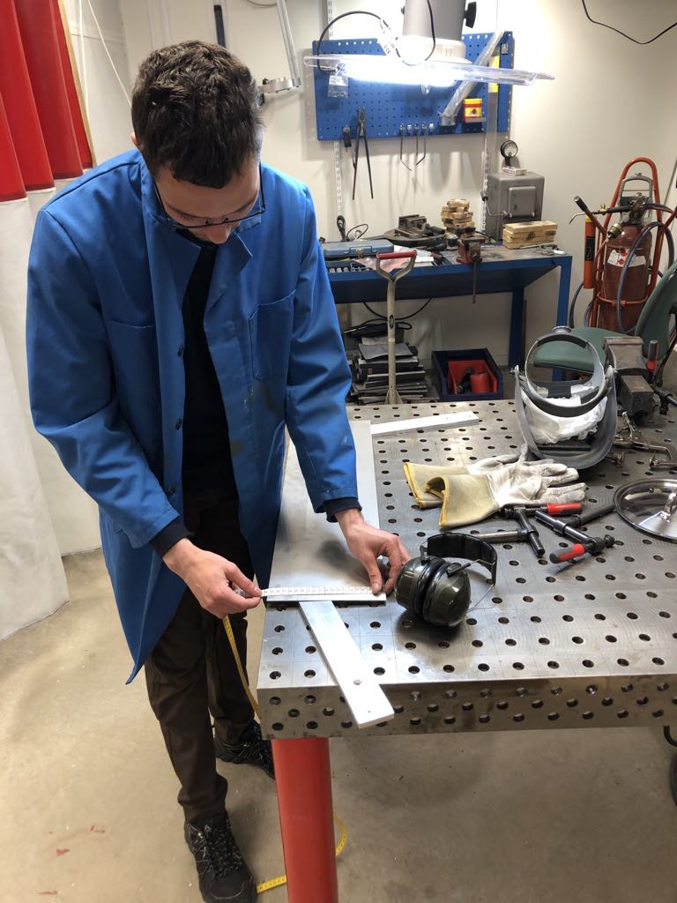
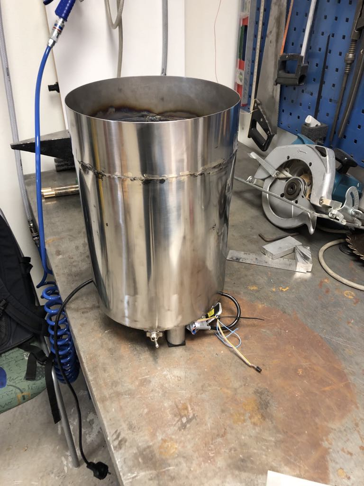
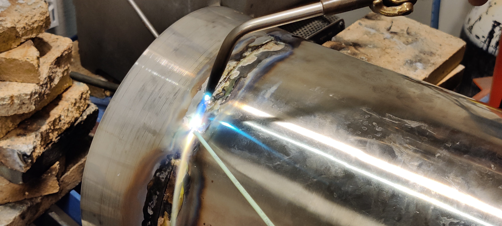
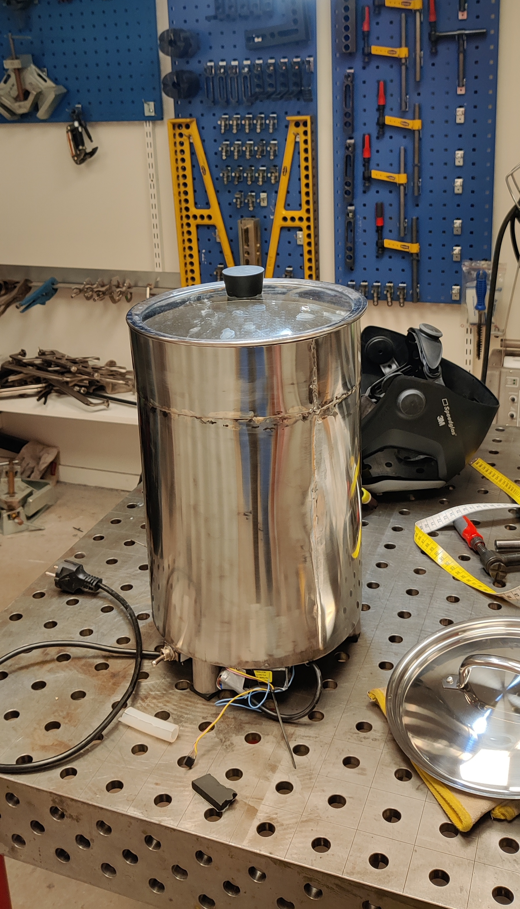
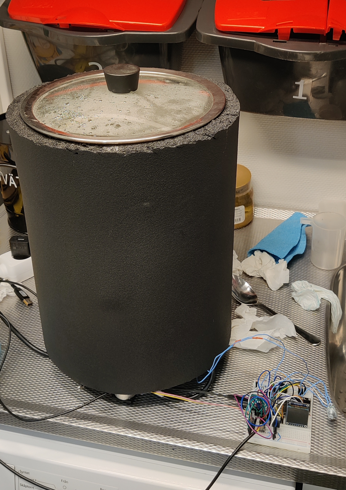

# MashMachine

An automated homebrewing system developed around a modified Vevor mash tun, an ESP32-based controller and custom temperature regulation.

## Introduction

This project has been a great journey for me to learn even more about the subjects covered in the MPSYS (Systems, Control and Mechatronics) programme at Chalmers University of Technology.

I have specifically applied knowledge from two courses:

- **SSY230 – System Identification**
- **SSY285 – Design of Linear Control Systems**

The mash tun has served as a physical test platform for applying system identification and control theory to a real-world thermal system.

## Mash Tun Construction

The starting point for this project was a relatively basic mash tun from Vevor, which only supported simple heating through its original controller.

I decided to modify the vessel and develop a custom control system to improve temperature regulation and automate the brewing process.

The mechanical work involved modifying the stainless-steel vessel, welding components, installing the necessary hardware and constructing an insulated enclosure.

### Fabrication

The following photographs document parts of the fabrication process, including the initial measurements, stainless-steel vessel and welding.

### Welding and Assembly

### Finished Mash Tun

The finished vessel has an insulated exterior to reduce heat losses and improve thermal efficiency.

### Construction Videos

#### Welding

https://github.com/user-attachments/assets/f25a4e15-6e44-4505-bbf4-2bfe34d7de5a

https://github.com/user-attachments/assets/1c13a10b-537a-4cbe-8e05-aff711293a5b

## System Implementation

The original controller was removed and replaced with a custom-built ESP32-based control system.

Several hardware modifications were made:

- A circulation system was added using a pump.
- Piping was installed to allow continuous wort circulation.
- The original control electronics were replaced with an ESP32-based system.

The circulation system improves temperature uniformity and makes the system more suitable for model-based control.

The original system exhibited temperature overshoot of around 2°C. With the new controller, temperature regulation is significantly improved, with essentially no observable overshoot under normal operating conditions.

Additional functionality includes:

- Hop timers
- Mash programs
- Automated process control
- Home Assistant integration

## System Identification

In the System Identification course, I used the mash tun to collect both estimation and validation data.

Using the System Identification Toolbox in MATLAB, I derived state-space models for three different operating points:

- 50°C
- 65°C
- 70°C

### Estimation Data

### Validation Data

### ARMAX Model

All system matrices were computed in MATLAB and then implemented directly on the ESP32. The computational work was therefore performed offline rather than on the microcontroller.

## Control System Design

Once the state-space models had been obtained, I used the concepts from Design of Linear Control Systems to design controllers based on the identified models.

I initially implemented a state-feedback LQR controller and later extended it to an LQG controller by adding a Kalman filter for state estimation.

LQG requires an explicit state-space representation of the system dynamics. Unlike conventional PID control, which operates on the control error, LQG uses a model to estimate internal system states and calculate the control input.

However, the LQG controller turned out to be somewhat excessive for this application, since the system exhibits slow and stable thermal dynamics. A well-tuned PID controller would likely have been sufficient.

## Measurement System

The system initially used an NTC thermistor. This approach was eventually abandoned due to calibration difficulties and unreliable measurements.

### NTC Thermistor

The NTC sensor is strongly nonlinear and requires reliable calibration points consisting of temperature and resistance.

In practice, this introduced several problems:

- Calibration was sensitive to measurement noise.
- Small resistance errors could result in significant temperature errors.
- Obtaining consistent and accurate reference temperatures was difficult.

These issues resulted in deviations between measured and actual temperatures.

### PT100

The NTC was replaced with a PT100 resistance temperature detector (RTD).

The main reasons were:

- More linear temperature-resistance characteristics.
- More straightforward calibration.
- Stable and predictable measurements.

This change significantly improved the quality of the temperature measurements, which is particularly important for system identification and state estimation.

## Home Assistant Integration

The system is integrated with Home Assistant for monitoring and interaction.

A local Linux machine acts as a small server, running Home Assistant in a Docker container. The same setup also runs supporting services such as InfluxDB and Grafana.

Communication between the ESP32 and Home Assistant is handled using MQTT.

This setup enables:

- Real-time monitoring of temperature, control signals and system states.
- Logging data to InfluxDB for further analysis.
- Visualization of system behaviour in Grafana.
- Remote interaction through the Home Assistant interface.

The integration is useful not only for convenience, but also for collecting experimental data and observing controller performance over time.

## System Characteristics

The mash tun exhibits slow dynamics and significant thermal inertia.

Measurements are also affected by noise, making aggressive control unsuitable.

As a result, stability and consistent temperature regulation are more important than fast response.

## Challenges and Lessons Learned

The main difficulty in this project was not the controller design itself.

The most challenging aspects were:

- Obtaining reliable measurement data.
- Constructing a model that accurately represents the real system.
- Handling non-ideal behaviour in a physical system.
- Integrating mechanical, electrical and software components.

The project has provided an opportunity to apply theoretical concepts from system identification and control engineering to a practical application.

## Results

- Modified and insulated stainless-steel mash tun.
- Custom ESP32-based control system.
- Experimental system identification at multiple operating temperatures.
- State-space models derived using MATLAB.
- Implemented LQR and LQG controllers.
- Improved temperature measurement using a PT100.
- Significantly improved temperature regulation.
- Home Assistant, MQTT, InfluxDB and Grafana integration.

## Acknowledgements

A special thanks to my dad for giving me the opportunity to carry out the welding work at his workplace, **MTA Sahlgrenska**. His help made the fabrication of the stainless-steel mash tun possible, and I really appreciate his support throughout the project.
